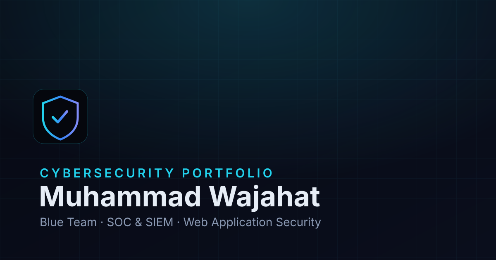

# Muhammad Wajahat — Cybersecurity Portfolio

A premium, dark-themed personal portfolio for **Muhammad Wajahat**, a
**Cybersecurity Penetration Tester** working across **offensive and defensive
security** with a **Purple Team** approach — penetration testing, vulnerability
assessment, web & API security, SIEM, threat hunting and security
investigations.

Built with Next.js (App Router), TypeScript, Tailwind CSS, Framer Motion and
Lucide icons — fully responsive, accessible, SEO-optimized and ready to deploy
on Vercel.



---

## ✨ Features

- **Premium dark-first design** — deep navy / near-black surfaces, electric blue
  & cyan accents, selective glassmorphism and a subtle cyber grid.
- **Dark / light mode toggle** with no flash of unstyled content (dark by default).
- **Professional profile photo** in the hero and about sections, served through
  Next.js Image optimization with a graceful initials fallback.
- **Sections**: Hero, About, Technical Skills (Offensive / Defensive / Purple
  Team / Networking), Certifications & Awards, Projects (with category filtering
  and rich detail cards), Hands-on Labs (offensive / defensive / purple), two-role
  Experience timeline, Education, Contact.
- **Working contact form** with client + server validation, honeypot spam
  protection, loading/success/error states, and optional email delivery.
- **Fully responsive** across mobile, tablet and desktop.
- **Accessible**: semantic HTML, skip-to-content link, focus-visible rings,
  `prefers-reduced-motion` support, ARIA attributes, keyboard-friendly.
- **SEO ready**: metadata, Open Graph & Twitter cards, JSON-LD person schema,
  `sitemap.xml`, `robots.txt`, custom SVG favicon and OG image.
- **Custom 404 page**, smooth scrolling, tasteful micro-interactions.
- **Content-driven**: all text, skills, certs, projects and labs live in a single
  editable file — [`lib/data.ts`](lib/data.ts).

---

## 🛠 Tech Stack

| Layer       | Technology                          |
| ----------- | ----------------------------------- |
| Framework   | [Next.js 15](https://nextjs.org) (App Router) |
| Language    | [TypeScript](https://www.typescriptlang.org) |
| Styling     | [Tailwind CSS 3](https://tailwindcss.com) |
| Animation   | [Framer Motion](https://www.framer.com/motion/) |
| Icons       | [Lucide React](https://lucide.dev) |
| Fonts       | Inter + JetBrains Mono (via `next/font`) |

---

## 🚀 Getting Started

### Prerequisites

- **Node.js 18.18+** (Node 20+ recommended)
- npm (or pnpm / yarn)

### 1. Install dependencies

```bash
npm install
```

### 2. Configure environment variables (optional)

Copy the example file and edit as needed:

```bash
cp .env.example .env.local
```

The site runs fully **without any environment variables**. They only enable
extras like a public site URL for SEO and real contact-form email delivery.
See [Contact form](#-contact-form) below.

### 3. Run the development server

```bash
npm run dev
```

Open [http://localhost:3000](http://localhost:3000).

### 4. Build for production

```bash
npm run build
npm run start
```

### 5. Lint

```bash
npm run lint
```

---

## ✏️ Editing Your Content

Almost everything is driven from **[`lib/data.ts`](lib/data.ts)** — update it to
change your bio, skills, certifications, projects, labs, education, experience
and contact details. No component edits required.

Common edits:

- **Contact email** — `profile.email` is intentionally `null`, so no email is
  shown publicly. Set it to your real professional inbox to display it everywhere.
- **Profile photo** — replace `public/images/waji.png` with your preferred
  portrait (keep the filename, or update `profile.photo`).
- **Resume** — replace `public/resume/Muhammad-Wajahat-Resume.pdf` with your real
  PDF (keep the same filename, or update `profile.resumePath`).
- **Experience dates** — set the exact role dates marked `// EDIT` in `experiences`.
- **Certifications** — add `credentialUrl` values to each entry in
  `certifications` once you have verification links. The Hack The Box **CDSA** is
  intentionally marked **"Currently Learning"**, not completed.
- **Projects** — add `repoUrl` / `liveUrl` once repositories and deployments are
  public. Training labs are clearly distinguished from personal projects.

> ⚠️ The content ships with honest placeholders. No fake statistics, credential
> IDs, issue dates, repositories or deployed links are fabricated — add real
> values as they become available.

---

## 📬 Contact Form

The contact endpoint lives at [`app/api/contact/route.ts`](app/api/contact/route.ts).

- **Out of the box**: it validates submissions server-side and acknowledges them
  (logging to the server console). No configuration needed to run or deploy.
- **To deliver emails to your inbox**: add [Resend](https://resend.com)
  credentials to `.env.local`:

  ```bash
  RESEND_API_KEY=your_key
  CONTACT_TO_EMAIL=your-inbox@example.com
  CONTACT_FROM_EMAIL=portfolio@your-verified-domain.com
  ```

  These are **server-only** variables (no `NEXT_PUBLIC_` prefix) and are never
  exposed in the browser bundle. **Never commit real keys** — `.env.local` is
  git-ignored.

---

## 📁 Project Structure

```
.
├── app/
│   ├── api/contact/route.ts   # Contact form backend (no keys exposed)
│   ├── globals.css            # Theme tokens + base styles
│   ├── layout.tsx             # Metadata, OG, fonts, theme init
│   ├── page.tsx               # Home page (assembles sections)
│   ├── not-found.tsx          # Custom 404
│   ├── robots.ts / sitemap.ts # SEO
├── components/
│   ├── layout/                # Navbar, Footer
│   ├── sections/              # Hero, About, Skills, Projects, ...
│   ├── providers/             # Theme provider (dark/light)
│   └── ui/                    # Reusable primitives (Section, Reveal, ...)
├── lib/
│   ├── data.ts                # ← All editable content
│   └── utils.ts
└── public/                    # favicon.svg, og.svg, resume PDF
```

---

## ☁️ Deploying to Vercel

1. Push this repository to GitHub (see commands below).
2. Import the repo at [vercel.com/new](https://vercel.com/new).
3. Framework preset is auto-detected as **Next.js** — no build config needed.
4. (Optional) Add environment variables from `.env.example` in the Vercel
   dashboard, including `NEXT_PUBLIC_SITE_URL` set to your production domain.
5. Deploy. 🎉

Any Node-compatible host (Netlify, Render, a Node server) also works via
`npm run build` + `npm run start`.

---

## 🔒 Security Notes

- No secrets, API keys or tokens are committed; `.env*` files are git-ignored.
- Security response headers are set in [`next.config.mjs`](next.config.mjs).
- The contact API sanitizes and length-limits all input and includes a honeypot.
- `npm audit` may report advisories in **build-time** tooling bundled by Next.js
  (its internal PostCSS copy) and ESLint's dependency chain. These do not affect
  the deployed static site; resolving them upstream requires a future Next.js
  major upgrade.

---

## 📄 License

Personal portfolio — all content © Muhammad Wajahat. You're welcome to use the
code structure as a reference for your own portfolio.

---

Built with Next.js, TypeScript & Tailwind CSS.
